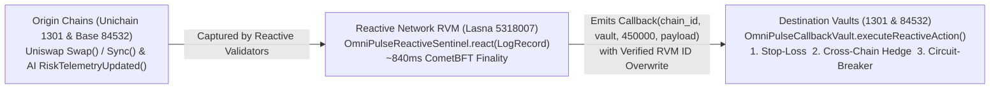
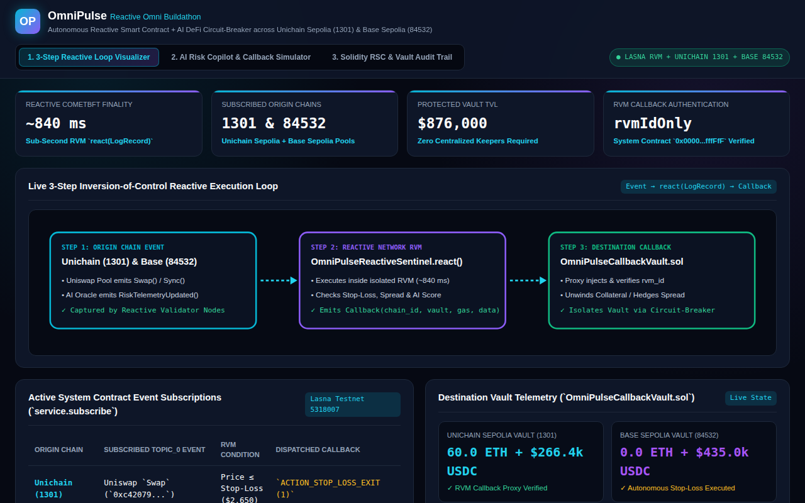
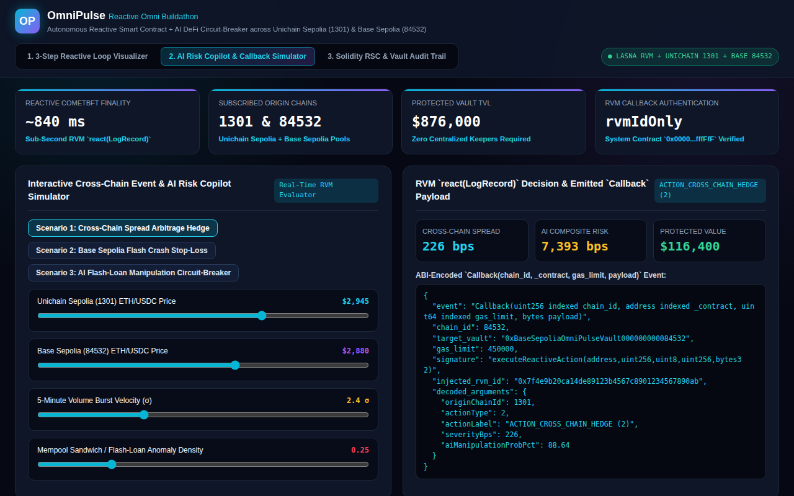
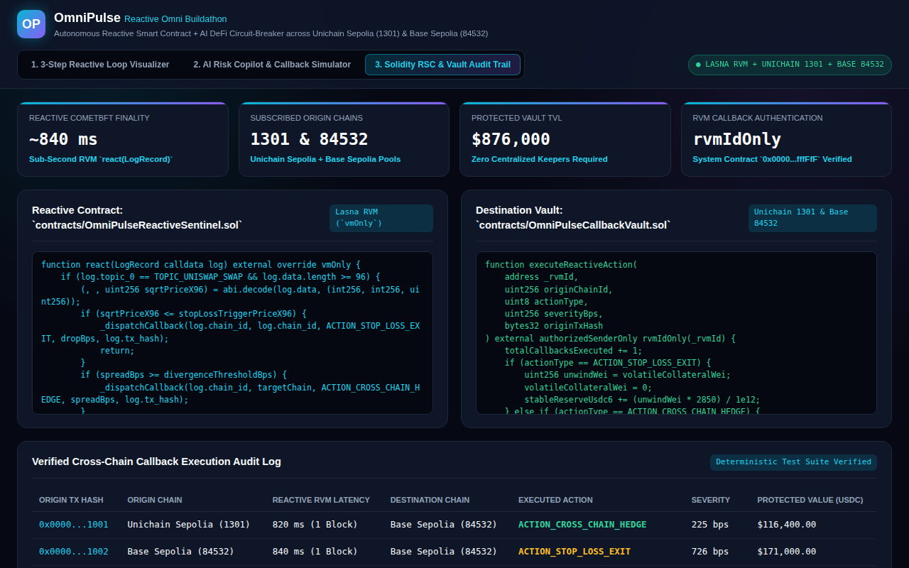

# OmniPulse: Reactive Smart Contract + AI DeFi Circuit-Breaker & Cross-Chain Automation Engine

> **Reactive Omni Buildathon Submission (DoraHacks — `$5,500 USD` in REACT)**  
> **Live Interactive Web Dashboard:** [https://jeffrey-graham.github.io/reactive-omni-ai-sentinel/](https://jeffrey-graham.github.io/reactive-omni-ai-sentinel/)  
> **60-Second 1080p Walkthrough Video:** [`demo.mp4`](demo.mp4)  
> **Reactive Smart Contract:** [`contracts/OmniPulseReactiveSentinel.sol`](contracts/OmniPulseReactiveSentinel.sol)  
> **Destination Callback Vault:** [`contracts/OmniPulseCallbackVault.sol`](contracts/OmniPulseCallbackVault.sol)

> [!NOTE]
> **Implementation & Deployment Status:** This repository is an architectural prototype and deterministic local simulation designed for Reactive Network (Lasna / Kopli Testnet), Unichain Sepolia (`1301`), and Base Sepolia (`84532`). The Solidity contracts are **not yet deployed to live testnets** (no live contract addresses or broadcast transactions yet), and the GitHub Pages web dashboard runs an offline client-side simulation rather than live RPC calls.

---

## 1. Problem Statement

Multi-chain liquidity providers and DeFi vaults deployed across high-speed L2s (**Unichain Sepolia `1301`** and **Base Sepolia `84532`**) suffer from severe vulnerabilities:
1. **Reliance on Centralized Off-Chain Keepers:** Traditional stop-loss bots and cross-chain hedges depend on centralized off-chain cron jobs or keeper relayers that fail or lag during extreme volatility spikes.
2. **Cross-Chain Price Divergence & Flash-Loan Manipulation:** When a pool on Unichain experiences a sudden price dislocation or flash-loan sandwich attack, liquidity on Base remains exposed unless an autonomous cross-chain circuit breaker reacts within a single block (`<1s`).

---

## 2. Solution & Inversion-of-Control Reactive Architecture

**OmniPulse** replaces centralized off-chain keepers with an autonomous **3-Step Reactive Smart Contract Loop** powered by the **Reactive Network (Lasna / Kopli Testnet)** and an **AI Risk Copilot**:



### Smart Contracts (`contracts/`)
- **`contracts/interfaces/IReactive.sol`, `AbstractReactive.sol`, `AbstractCallback.sol`:** Canonical Reactive Network interfaces binding to System Contract `0x0000000000000000000000000000000000fffFfF` with `rnOnly`, `vmOnly`, `authorizedSenderOnly`, and `rvmIdOnly(_rvmId)` security modifiers.
- **`contracts/OmniPulseReactiveSentinel.sol`:**
  - Registers 4 cross-chain event subscriptions via `service.subscribe(...)` across **Unichain Sepolia (`1301`)** and **Base Sepolia (`84532`)**.
  - Inside `react(LogRecord calldata log)`, decodes real-time pool prices and AI risk scores and dispatches authenticated `Callback` events when:
    1. **Stop-Loss Threshold Breach (`ACTION_STOP_LOSS_EXIT = 1`):** Pool price drops below `$2,650`.
    2. **Cross-Chain Spread Divergence (`ACTION_CROSS_CHAIN_HEDGE = 2`):** Unichain vs Base spread $\ge 120$ bps.
    3. **AI Manipulation Alert (`ACTION_CIRCUIT_BREAKER_PAUSE = 3`):** Composite AI risk score $\ge 8,000$ bps (`80%` manipulation probability), isolating vaults on both chains simultaneously.
- **`contracts/OmniPulseCallbackVault.sol`:**
  - Designed for destination deployment on **Unichain Sepolia (`1301`)** and **Base Sepolia (`84532`)** (currently verified in local simulation; not yet deployed on-chain), verifying the injected `_rvmId` and modeling atomic collateral unwinds, delta-neutral hedging, or emergency circuit-breaker pauses.

---

## 3. Visual Previews

| 3-Step Reactive Loop Visualizer | AI Risk Copilot & Callback Simulator | Solidity RSC & Vault Audit Trail |
| :---: | :---: | :---: |
|  |  |  |

---

## 4. Quickstart & Deterministic Verification Suite

```bash
# 1. Run the deterministic 3-step Origin Event -> react() -> Callback simulation
python3 src/ai_risk_copilot.py

# 2. Run the automated unit & integration test suite
python3 -m unittest discover -s tests -v
```
